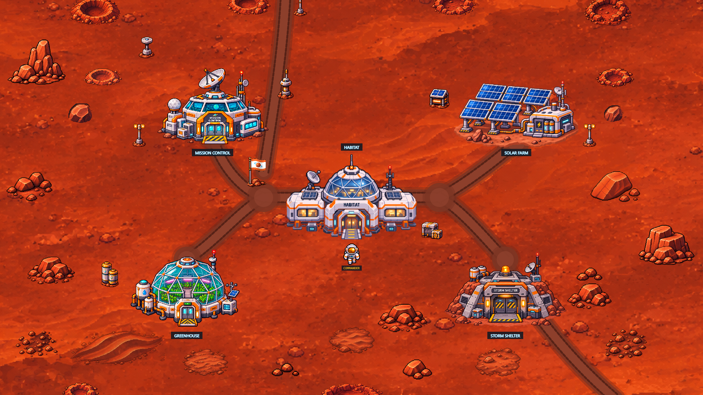
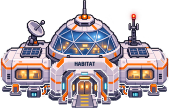
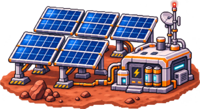
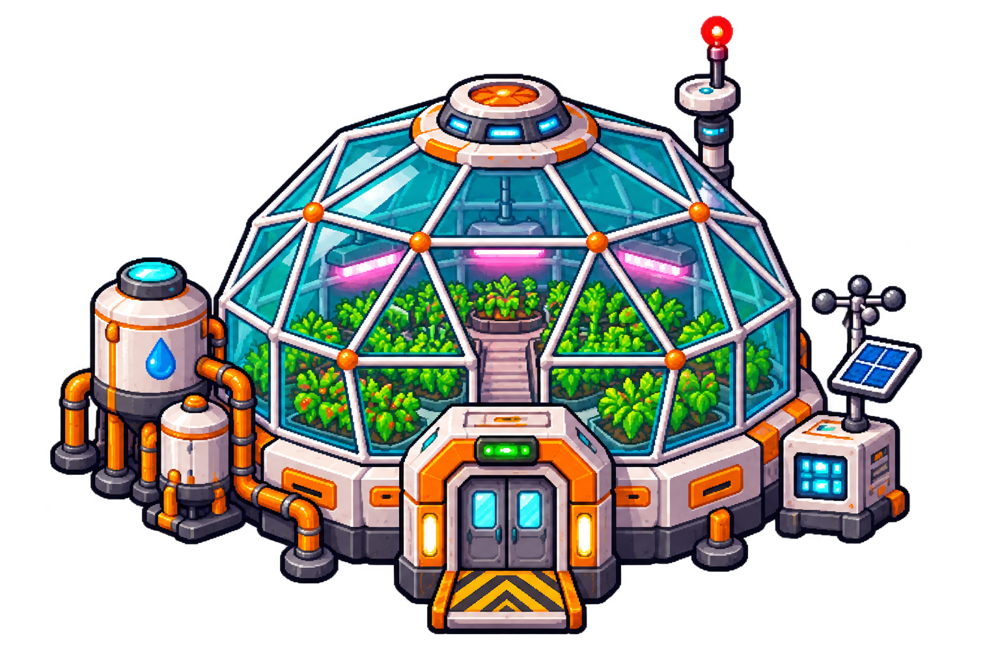
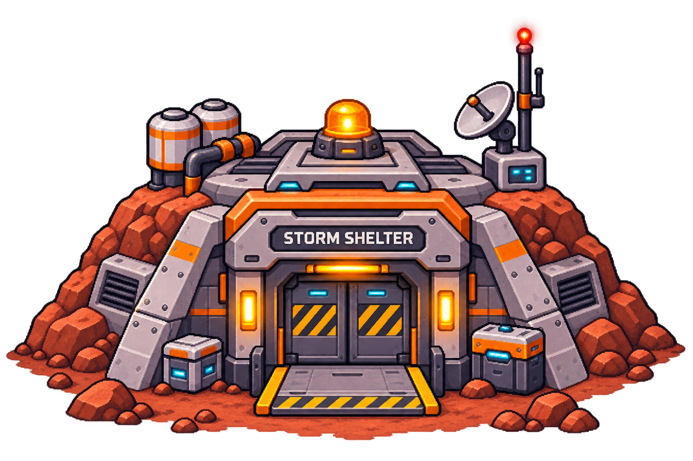
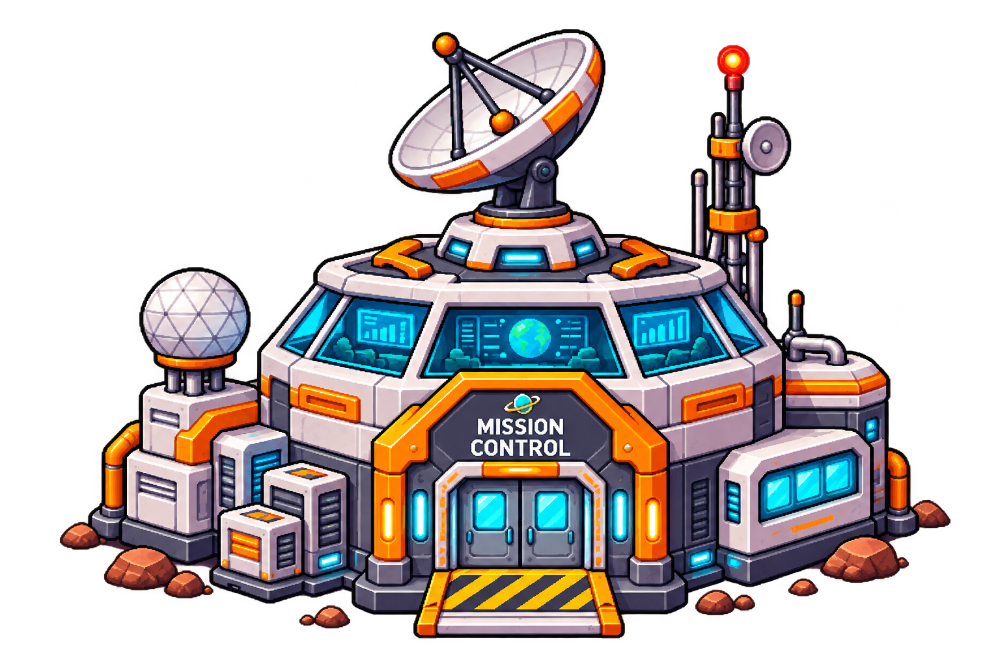
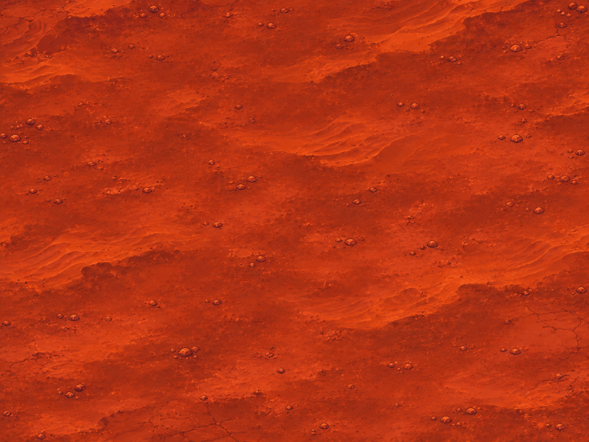
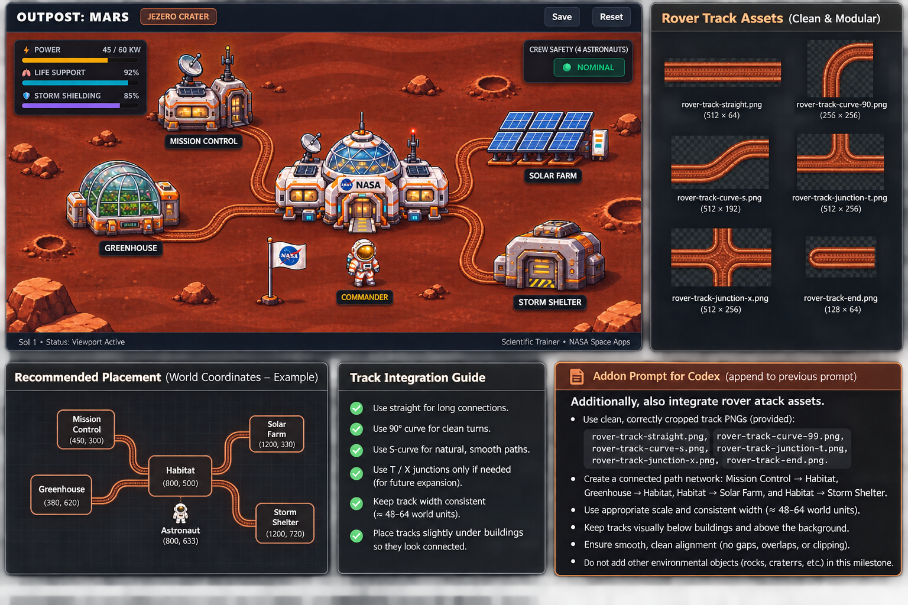
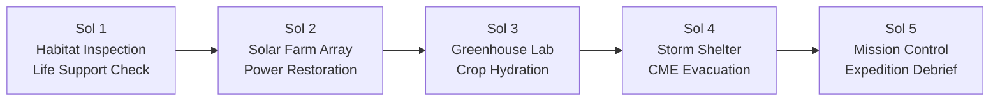

<div align="center">

# OUTPOST: MARS

### *Explore. Discover. Survive.*

**An educational 2D Mars outpost simulation and mission trainer designed for young explorers (ages 7–12), built with Phaser 3, TypeScript, and authentic NASA spaceflight data.**

<br/>

[](https://www.spaceappschallenge.org/)
[](https://phaser.io/)
[](https://www.typescriptlang.org/)
[](https://vitejs.dev/)
[](tests/)
[](src/data/snapshots/)
[](#)

<br/>



<p><em>Jezero Crater Outpost — High-resolution 1600 &times; 1200 top-down Martian surface exploration viewport.</em></p>

</div>

---

## Mission Briefing

**OUTPOST: MARS** is a browser-based, educational space simulation game developed for the **NASA Space Apps Challenge**. Stationed in Jezero Crater, players take on the role of an outpost commander responsible for keeping humanity's first Martian colony operational. 

Exploration is grounded in authentic space science: players navigate realistic Martian terrain along rover tracks, inspect five mission-critical buildings, study real flight telemetry from NASA repositories, and balance life support, electrical power, and storm shielding systems across a challenging five-Sol campaign.

- **Target Audience:** Young explorers and students aged 7–12, science educators, and space enthusiasts.
- **Core Objective:** Explore the Martian surface, master real spaceflight science, solve interactive data challenges, and ensure colony survival across five sequential Sols.

---

## Outpost Colony Infrastructure

The Jezero Crater colony consists of five canonical facilities connected by an engineered rover-track network:

<div align="center">

| Habitat | Solar Farm | Greenhouse | Storm Shelter | Mission Control |
| :---: | :---: | :---: | :---: | :---: |
|  |  |  |  |  |
| **Living Quarters**<br/>Atmospheric scrubbers & crew health | **Power Generation**<br/>Photovoltaic panels & dust mitigation | **Hydroponics Lab**<br/>Crop growth & transpiration recycling | **Regolith Bunker**<br/>Subterranean radiation shielding | **Operations Hub**<br/>Orbital relay & science telemetry |

</div>

---

## Core Features

- 🚀 **Martian Surface Exploration:** Smooth 4-directional traversal across a $1600 \times 1200$ Martian world bounded by geological formations, craters, boulders, and dust patches.
- 🧑‍🚀 **Directional Astronaut Animations:** Multi-frame directional walking animations (North, South, East, West) and resting idle frames mapped from an authentic astronaut character spritesheet.
- 🏛️ **Five Interactive Outpost Buildings:** Detailed facilities each featuring dedicated educational field guides, interactive operational tasks, and real spaceflight parallels.
- 📅 **Five-Sol Survival Campaign:** Progressive mission storyline covering atmospheric scrubber checks, solar panel dust management, greenhouse crop hydration, Coronal Mass Ejection emergency evacuation, and Earth communications.
- ⚡ **Dynamic Resource Management:** Real-time telemetry monitoring **Power (kW)**, **Life Support (%)**, **Storm Shielding (%)**, and overall **Crew Safety** (`nominal`, `alert`, `safe`, `critical`).
- 🔬 **Real NASA Scientific Telemetry:** Integrated offline snapshots from NASA DONKI space weather events, Curiosity rover Gale Crater radiation dosimetry, OSDR RadLab data, and OSDR space biology studies.
- 🧪 **Three Interactive Science Challenges:** Hands-on scientific mini-investigations exploring solar flare classifications, microgravity plant biology, and human exploration consumable supply calculations.
- 📖 **Persistent Science Log:** In-game research journal logging completed scientific investigations, educational discoveries, and authentic NASA source provenance citations.
- 🎓 **Guided First-Time Tutorial:** Interactive step-by-step onboarding overlay introducing keyboard/touch movement, facility proximity triggers, field guides, and mission HUD navigation.
- 💾 **State Persistence & Granular Reset:** Complete mission save/reload functionality backed by browser `localStorage`, with granular reset controls (replay tutorial or reset mission).
- 📱 **Cross-Platform Responsive Viewport:** Responsive scaling engineered for desktop screens and mobile-landscape touch devices, complete with a virtual joystick and touch action controls.
- 🔒 **Zero-Dependency Offline Architecture:** All telemetry is bundled locally; no external network requests or judge-facing API keys are required at runtime.

---

## Gameplay & Telemetry Showcase

<div align="center">

### In-Engine Visual Assets

| Mars Outpost Surface | Commander Astronaut | Rover Transit Network |
| :---: | :---: | :---: |
|  |  |  |
| *Jezero Crater base terrain* | *Animated EVA astronaut* | *Approved rover-track pathways* |

</div>

### In-Game UI Viewports

The following telemetry views and consoles are accessible during live gameplay:

| Viewport | Component | Description |
| :--- | :--- | :--- |
| **Colony Surface & HUD** | `MarsScene` + `HUD` | Real-time heads-up display displaying Power, Life Support, Storm Shielding levels, current Sol, and active mission objectives. |
| **Building Field Guide** | `BuildingInteractionUI` | Interactive dialog consoles presenting facility architecture, operational controls, trivia, and authentic NASA mission parallels. |
| **NASA Science Console** | `ScienceChallengesUI` | Dedicated science console for solving space weather radiation assessments, greenhouse biology challenges, and BVAD supply problems. |
| **Interactive Tutorial** | `TutorialUI` | Guided visual overlay welcoming first-time commanders and guiding them step-by-step to their first building inspection. |
| **Mission Debrief** | `MissionFeedback` | Outcome reports evaluating commander decisions, resource recovery deltas, and five-Sol expedition completion status. |

> [!TIP]
> **Live Gameplay Capture:** To capture fresh high-resolution in-game screenshots for press or documentation, run `npm run dev` and press `F12` to capture the `#game-container` viewport at standard $1280 \times 720$ or $1920 \times 1080$ resolutions.

---

## Real NASA Science. Interactive Learning.

OUTPOST: MARS grounds every game mechanic in real aerospace data. All scientific figures adhere to a strict three-tier truth taxonomy:

<div align="center">

| Tier | Badge | Definition | Application in OUTPOST: MARS |
| :---: | :---: | :--- | :--- |
| **1** | <span style="background-color: #0369a1; color: #f0f9ff; padding: 3px 8px; border-radius: 4px; font-weight: bold; font-size: 11px;">REAL</span> | Directly reported empirical data from flight instruments, ground sensors, or peer-reviewed literature. | Curiosity RAD Gale Crater surface measurements, DONKI flare logs, OSDR study metadata. |
| **2** | <span style="background-color: #6b21a8; color: #faf5ff; padding: 3px 8px; border-radius: 4px; font-weight: bold; font-size: 11px;">DERIVED</span> | Values calculated directly from source measurements using standard physical, orbital, or biological equations. | WSA-ENLIL heliospheric CME shock propagation speeds and interplanetary transit arrival times. |
| **3** | <span style="background-color: #b45309; color: #fffbeb; padding: 3px 8px; border-radius: 4px; font-weight: bold; font-size: 11px;">GAME-SIMPLIFIED</span> | Pedagogical approximations or balanced parameters designed to make complex science accessible to children. | 30-day consumable arithmetic, simplified crop photoperiod factors, and storm shield percentages. |

</div>

<br/>

### Bundled Offline Telemetry Snapshots (`src/data/snapshots/`)

```text
src/data/snapshots/
├── curiosity-rad.json     # Gale Crater surface radiation dosimetry baseline & Sol 242 event
├── donki-events.json      # Solar Cycle 25 Coronal Mass Ejections, solar flares, and SEP events
├── osdr-studies.json      # Spaceflight microgravity biological research (OSD-661 / OSD-121)
└── radlab-dosimetry.json  # ISS Columbus laboratory DOSIS 3D radiation telemetry
```

#### Detailed Dataset Provenance & Boundaries

| Source | Instrument & Mission | Primary Data Record | Scientific Role & Boundary Notes |
| :--- | :--- | :--- | :--- |
| **NASA DONKI**<br/>[Space Weather Database](https://kauai.ccmc.gsfc.nasa.gov/DONKI/) | SOHO LASCO, STEREO SECCHI, GOES | May 2024 Extreme Storm CME & Flare Records | Supplies historical Coronal Mass Ejection parameters and X/M-class solar flare profiles for Sol 4 space weather alerts. Shock arrival estimates derive from WSA-ENLIL heliospheric models. |
| **Curiosity RAD**<br/>[NASA PDS / Science 2014](https://pds.nasa.gov/ds-view/pds/viewProfile.jsp?dsid=MSL-M-RAD-3-RDR-V1.0) | Radiation Assessment Detector (RAD), MSL Curiosity | $0.64 \pm 0.12\text{ mSv/day}$ Gale Crater baseline | Authentic empirical baseline for Galactic Cosmic Ray (GCR) exposure on the surface of Mars across the first 300 Sols, including the Sol 242 solar energetic particle event. |
| **NASA OSDR RadLab**<br/>[RadLab Telemetry API](https://visualization.osdr.nasa.gov/radlab/api/) | DOSIS 3D (DosTel1), ISS Columbus Lab | Low Earth Orbit absorbed dose rates ($\mu\text{Gy/h}$) | Space radiation reference baseline. **Caveat:** Taken in Low Earth Orbit behind Earth's geomagnetic shield and station hull. Used as an orbital comparative benchmark, **not** Mars surface data. |
| **NASA OSDR Studies**<br/>[OSDR Research Portal](https://osdr.nasa.gov/bio/repo/data/studies/OSD-661) | DXA Scanners & Immunoblotting (ISS RR Missions) | Musculoskeletal disuse & bone mineral density | Preclinical spaceflight research (OSD-661, OSD-121) demonstrating microgravity bone degradation and the role of molecular targets in space biology. |
| **NASA BVAD Reference**<br/>[NASA NTRS 20210024855](https://ntrs.nasa.gov/api/citations/20210024855/downloads/BVAD_2.15.22-final.pdf?attachment=true) | Exploration Architecture Standards | $0.84\text{ kg } O_2/\text{day}$, $2.50\text{ L } H_2O/\text{day}$ per person | Baseline Values for Exploration Populations (BVAD 2022). **Caveat:** Planning reference standards for mission logistics, **not** measurements on Mars. Cited directly; no JSON file bundled. |

> [!IMPORTANT]
> **Orbital Telemetry vs. Martian Surface Measurements:**  
> RadLab observations from the International Space Station occur in Low Earth Orbit (LEO) at ~419 km altitude. These detectors operate inside Earth's protective magnetosphere and within shielded station modules. In OUTPOST: MARS, RadLab figures serve strictly as comparative spaceflight benchmarks and are explicitly distinguished from Curiosity RAD's unshielded surface measurements on Mars.

> [!NOTE]
> **Exploration Planning Standards vs. Measured Telemetry:**  
> Daily metabolic life-support baselines ($0.84\text{ kg } O_2$ and $2.50\text{ L } H_2O$ per astronaut) are derived from the **NASA Baseline Values for Exploration Populations (BVAD 2022)**. These values represent mission-design planning baselines rather than environmental measurements taken on the Martian surface.

---

## Gameplay & Controls Guide

### Control Schemes

| Action | Desktop Controls | Mobile / Touch Controls | Function |
| :--- | :--- | :--- | :--- |
| **Move Astronaut** | `W` `A` `S` `D` or `Arrow Keys` | Virtual D-Pad (Touch & Drag) | Navigate through the colony along roads and terrain |
| **Interact / Inspect** | `E` (when near building) | Tap "Interact" Prompt / Action Button | Open facility field guide, view telemetry, perform tasks |
| **Close / Dismiss** | `Escape` or `✕` Button | Tap Close Button (`✕`) | Dismiss active field guides, consoles, or tutorial overlays |
| **Open Science Log** | Click **Science Log** in header | Tap **Science Log** in header | View discovered science findings and NASA citations |
| **Save Progress** | Click **Save** in header | Tap **Save** in header | Persist mission state and discoveries to `localStorage` |
| **Reset Outpost** | Click **Reset** in header | Tap **Reset** in header | Open reset modal (replay tutorial or reset mission) |
| **Help / Tutorial** | Click **Help** in header | Tap **Help** in header | Reopen the interactive onboarding walkthrough |

### Five-Sol Survival Campaign



1. **Sol 1 — Habitat Life Support:** Inspect crew quarters, check $CO_2$ scrubbers, and balance baseline life-support reserves ($0.84\text{ kg } O_2/\text{day}$).
2. **Sol 2 — Solar Power Restoration:** Survey photovoltaic arrays following atmospheric dust settling to clean panels and recover electrical wattage.
3. **Sol 3 — Greenhouse Hydroponics:** Verify hydration loops and nutrient circulation for fast-growing micro-greens to maintain food stability.
4. **Sol 4 — Space Weather Storm Emergency:** NASA DONKI detects an Earth-directed/Mars-aligned Coronal Mass Ejection shock front; sound the alarm and evacuate the crew to the regolith Storm Shelter.
5. **Sol 5 — Mission Control Debrief:** Establish high-gain orbital communication uplink with Earth, transmit the Science Log, and complete the expedition.

### Interactive Science Challenges

Commander challenges are launched directly from the **Science Log**:

- 🔭 **Challenge 1: Radiation Detective (Curiosity RAD & DONKI)**  
  Examine NOAA solar flare classifications (X-class vs. M-class) and evaluate surface dose rates measured by Curiosity RAD in Gale Crater ($0.64\text{ mSv/day}$) against space weather events.
- 🌱 **Challenge 2: Space Botanist (NASA OSDR Studies)**  
  Configure optimal light spectrum ratios (red/blue LEDs) and nutrient circulation in the Greenhouse based on authentic NASA microgravity plant biology experiments.
- 📦 **Challenge 3: Life Support Logistics (NASA BVAD Planning Reference)**  
  Calculate 30-day consumable supplies (oxygen mass and water volume) for a 4-person exploration crew using NASA BVAD exploration planning standards.

---

## Technology Stack

OUTPOST: MARS is engineered with a modern, high-performance web development stack:

<div align="center">

| Technology | Role | Version |
| :--- | :--- | :--- |
|  | **Game Engine & Rendering** | 2D WebGL/Canvas game engine, Arcade Physics, sprite animators, camera lerping |
|  | **Core Language** | Static type safety for game models, scientific schemas, and state engines |
|  | **Build Tool & Bundler** | High-velocity development server with Hot Module Replacement (HMR) and Rollup bundling |
|  | **Test Runner** | Automated unit, integration, and data validation testing suite |
|  | **Script Bundling** | High-speed data snapshot ingestion and validation bundler |
|  | **UI & Overlays** | Semantic DOM HUD, responsive overlays, accessible ARIA roles, virtual joystick |
|  | **State Persistence** | Client-side deterministic persistence for mission saves and completed challenges |

</div>

---

## Project Architecture

```text
Outpost-Mars/
├── public/assets/                 # Static runtime game assets
│   ├── buildings/                 # Approved building artwork (habitat, greenhouse, etc.)
│   ├── characters/                # Approved astronaut animation sheet & static fallback
│   └── environment/               # Terrain background, craters, rocks, boulders, rover tracks
├── src/
│   ├── assets/styles.css          # Responsive HUD, overlays, modal styling, touch controls
│   ├── core/                      # Pure business logic and state machine
│   │   ├── mission.ts             # Five-Sol campaign rules, objectives, and recovery logic
│   │   ├── science-challenges.ts  # Science challenge data models and BVAD formulas
│   │   ├── state.ts               # GameState initialization, normalization, and persistence
│   │   ├── storage.ts             # LocalStorage serialization and migration routines
│   │   └── types.ts               # Core TypeScript interfaces for game entities
│   ├── data/                      # NASA scientific data subsystem
│   │   ├── snapshots/             # Verified offline JSON data snapshots
│   │   ├── loader.ts              # Snapshot loader with fail-safe error handling
│   │   ├── types.ts               # Scientific taxonomy, provenance, and dataset models
│   │   └── validation.ts          # Runtime validators ensuring snapshot structural integrity
│   ├── game/                      # Phaser 3 game implementation
│   │   ├── config.ts              # Phaser GameConfig, scale modes, pixel-art render flags
│   │   ├── index.ts               # Phaser game lifecycle instance initializer
│   │   ├── building-events.ts     # Building interaction custom event constants
│   │   ├── tutorial-events.ts     # Onboarding tutorial event bus
│   │   ├── scenes/MarsScene.ts    # Main exploration scene: terrain, sprites, physics, camera
│   │   └── textures/              # Procedural texture fallbacks and Martian color palette
│   ├── ui/                        # DOM HUD and interactive overlay managers
│   │   ├── building-interactions.ts # Field guide dialogs and mission objective displays
│   │   ├── first-time-tutorial.ts # New player interactive onboarding tour
│   │   ├── hud.ts                 # Resource status indicators (Power, Life Support, Shield)
│   │   └── science-challenges.ts  # Science console dialogs and persistent Science Log UI
│   └── main.ts                    # Application entry point wiring Phaser with DOM UI
├── tests/                         # Vitest automated test suite (81 passing tests)
│   ├── data/                      # Snapshot validation, loading, and ingestion safety tests
│   ├── foundation.test.ts         # Initial state baseline and resource bounds tests
│   ├── mission.test.ts            # Five-Sol campaign progression and recovery tests
│   ├── phaser-foundation.test.ts  # Phaser config, viewport scale, and boundary tests
│   ├── science-challenges.test.ts # Challenge validation and supply calculation tests
│   └── storage.test.ts            # LocalStorage persistence and migration tests
├── docs/                          # Architecture blueprints, scoring criteria, and QA plans
├── index.html                     # Application HTML5 shell with viewport containers
├── package.json                   # Project dependencies and npm scripts
├── tsconfig.json                  # TypeScript compiler configuration
└── vite.config.ts                 # Vite bundler and path alias configuration
```

---

## Getting Started

### Prerequisites
- **Node.js:** v18.0.0 or higher
- **npm:** v9.0.0 or higher

### Installation & Local Development

```bash
# 1. Clone the repository
git clone https://github.com/your-username/Outpost-Mars.git
cd Outpost-Mars

# 2. Install project dependencies
npm install

# 3. Launch local development server with Hot Module Replacement (HMR)
npm run dev

# 4. Run the automated Vitest test suite
npm test

# 5. Perform strict TypeScript type checking without emitting files
npx tsc --noEmit

# 6. Compile and bundle for production distribution
npm run build

# 7. Preview the production build locally
npm run preview
```

---

## Verification & Test Results

The repository includes a comprehensive automated test suite executed via Vitest, verifying state machines, campaign progression, storage persistence, and NASA schema conformance:

```text
Test Files  8 passed (8)
     Tests  81 passed (81)
  Duration  735ms
```

- **Project Foundation (`tests/foundation.test.ts`):** Validates initial resource allocations, NASA BVAD exploration standard figures, and core module registration.
- **Mission Engine (`tests/mission.test.ts`):** Tests ordered Sol 1–5 progression, building trigger sequences, emergency power recovery, and legacy save migration.
- **Science Challenges (`tests/science-challenges.test.ts`):** Verifies supply calculation math, Science Log state tracking, and idempotent rewards.
- **Storage Persistence (`tests/storage.test.ts`):** Verifies state serialization to `localStorage`, discovery flags, and reset routines.
- **Phaser 3 Foundation (`tests/phaser-foundation.test.ts`):** Verifies GameConfig parameters, responsive scale manager, pixel-art rendering flags, zero-gravity physics, canonical building coordinates, and color palette tokens.
- **NASA Data Subsystem (`tests/data/`):** 60 tests validating schema integrity, offline loading, atomic updates, and transaction rollback failure safety.

---

## Credits & Disclaimer

### Scientific Data Credits
- **NASA Space Weather Database Of Notifications, Knowledge, Information (DONKI):** Space weather Coronal Mass Ejection, solar flare, and shock simulation event records.
- **NASA Planetary Data System (PDS) & MSL RAD Science Team:** Surface radiation dosimetry from the Mars Science Laboratory Curiosity Rover (*Hassler et al., Science 343, 2014*).
- **NASA Open Science Data Repository (OSDR) & RadLab:** Space radiation dosimetry from the ISS DOSIS 3D experiment and microgravity rodent biological research.
- **NASA Baseline Values for Exploration Populations (BVAD 2022):** Human exploration life support planning standards (*NASA NTRS 20210024855*).

### Disclaimer
**OUTPOST: MARS** is an educational game developed as a project for the **NASA Space Apps Challenge**. It is an independent educational initiative and is **not** an official product of the National Aeronautics and Space Administration (NASA), nor is it endorsed by NASA. All trademarks, mission names, and datasets belong to their respective originators.
