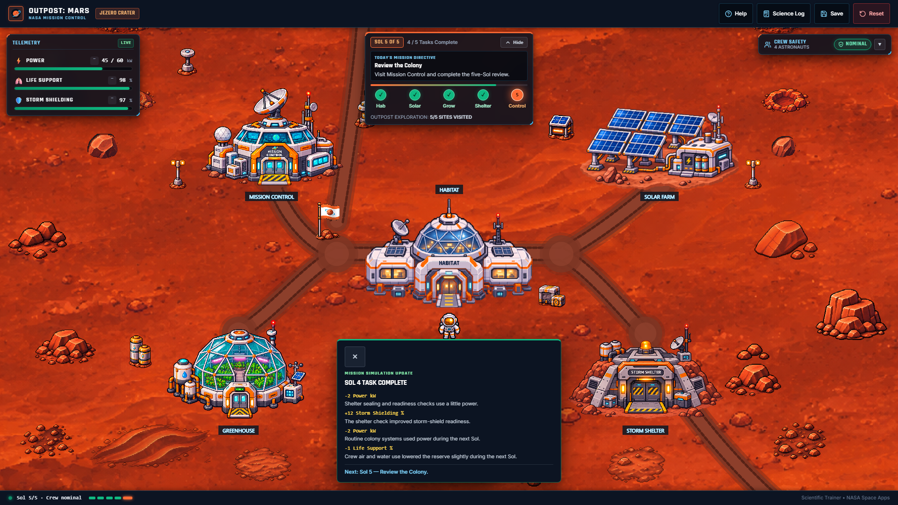
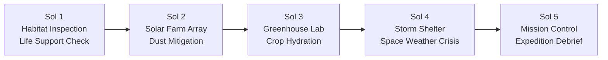
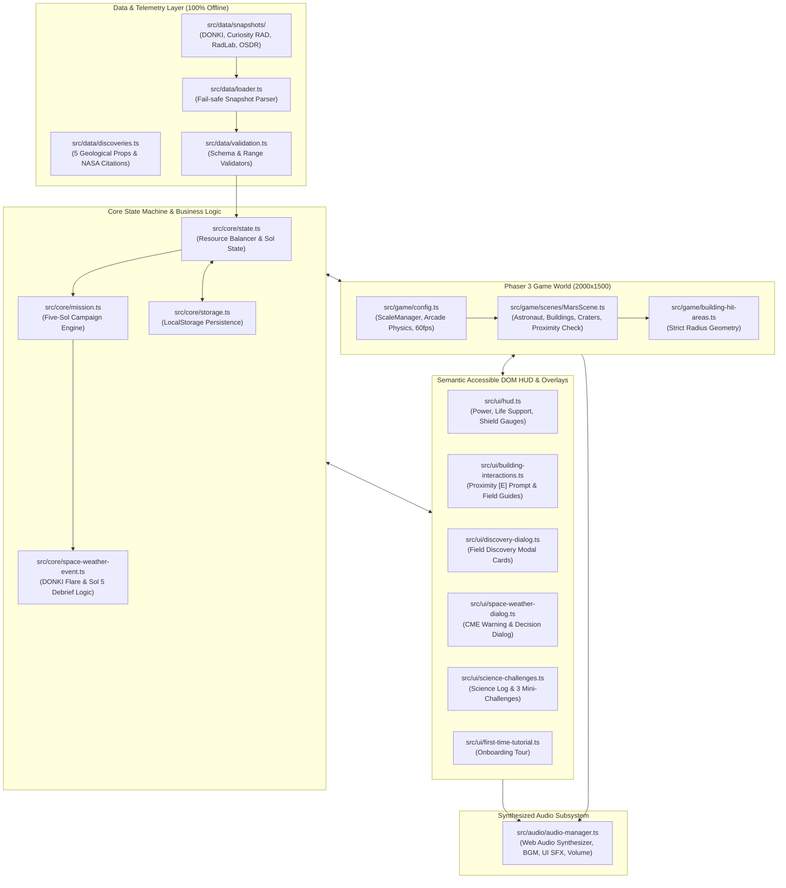
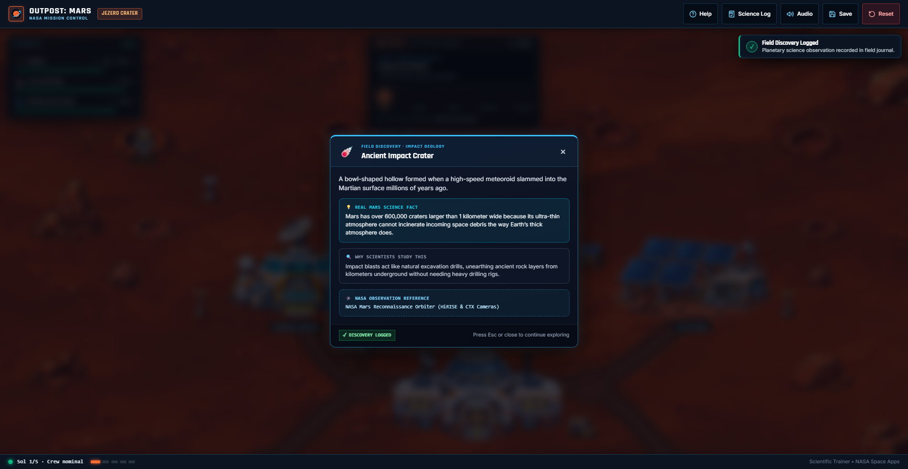
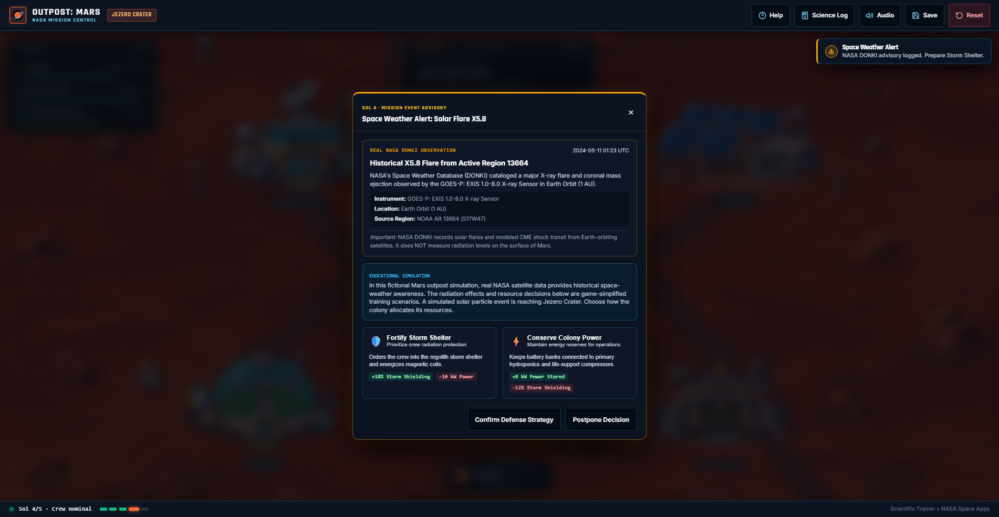
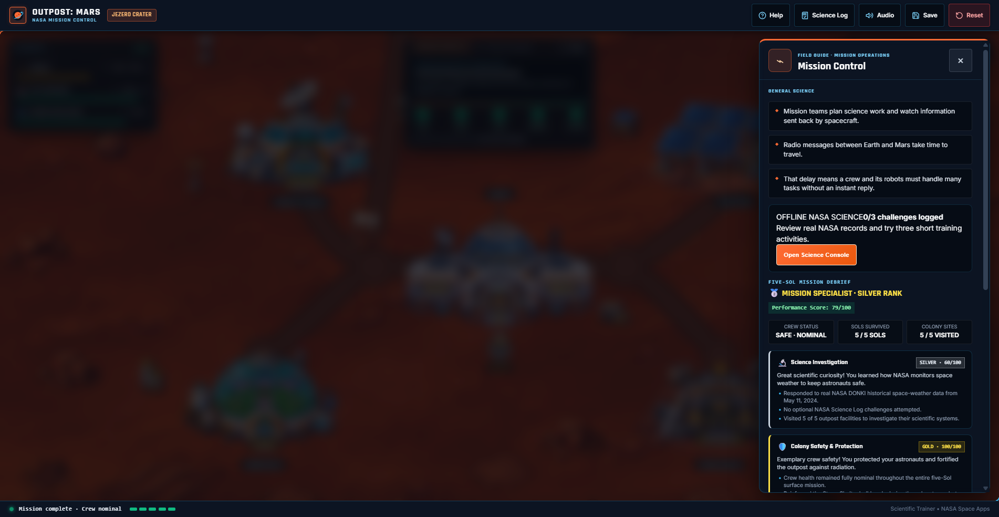

<div align="center">

# 🔴 OUTPOST: MARS

### *Explore. Discover. Survive.*

**An educational 2D Mars outpost simulation and mission trainer designed for young explorers (ages 7–12), built with Phaser 3, TypeScript, and authentic NASA spaceflight data.**

<br/>

[](https://www.spaceappschallenge.org/)
[](https://outpost-mars.vercel.app/)
[](https://ankitchamke.github.io/Outpost-Mars/)
[-10b981?style=for-the-badge&logo=vitest&logoColor=white)](tests/)
[](https://www.typescriptlang.org/)
[](https://phaser.io/)
[](https://vitejs.dev/)
[](#bundled-offline-telemetry-snapshots)
[](#accessibility--user-experience)

<br/>



<p><em>OUTPOST: MARS — High-resolution 2000 &times; 1500 Jezero Crater exploration viewport featuring the Commander Astronaut, rover transit network, five functional outpost modules, HUD telemetry, and authentic NASA space weather alerts.</em></p>

</div>

---

## 🌐 Live Project & Submission Links

| Destination | Platform / Type | URL / Access |
| :--- | :--- | :--- |
| 🚀 **Live Interactive Web Game (Primary)** | Vercel Cloud | **[https://outpost-mars.vercel.app/](https://outpost-mars.vercel.app/)** |
| 🌍 **Live Interactive Web Game (Mirror)** | GitHub Pages | **[https://ankitchamke.github.io/Outpost-Mars/](https://ankitchamke.github.io/Outpost-Mars/)** |
| 📦 **Open-Source Repository** | GitHub | **[https://github.com/ankitchamke/Outpost-Mars](https://github.com/ankitchamke/Outpost-Mars)** |
| 🏆 **NASA Space Apps Challenge** | Competition Portal | **[NASA Space Apps Challenge 2024](https://www.spaceappschallenge.org/)** |

> [!TIP]
> **Zero Installation, Instant Play:** OUTPOST: MARS is a 100% static, client-side web application. It requires zero plugins, zero browser extensions, and zero judge API keys. Works directly in Google Chrome, Microsoft Edge, Mozilla Firefox, and Safari on desktop and laptop screens.

---

## 📋 Table of Contents

1. [Mission Briefing & Concept](#mission-briefing--concept)
2. [Outpost Colony Infrastructure](#outpost-colony-infrastructure)
3. [Core Gameplay Systems](#core-gameplay-systems)
   - [Strict Proximity-Based Building Access](#strict-proximity-based-building-access)
   - [Interactive Mars Environmental Discoveries](#interactive-mars-environmental-discoveries)
   - [Five-Sol Mission Campaign](#five-sol-mission-campaign)
   - [NASA DONKI Space Weather Crisis & Mission Debrief](#nasa-donki-space-weather-crisis--mission-debrief)
   - [Interactive NASA Science Challenges](#interactive-nasa-science-challenges)
   - [Atmospheric Sci-Fi Audio Engine](#atmospheric-sci-fi-audio-engine)
4. [Real NASA Spaceflight Science & Truth Taxonomy](#real-nasa-spaceflight-science--truth-taxonomy)
   - [The Three-Tier Scientific Truth Taxonomy](#the-three-tier-scientific-truth-taxonomy)
   - [Bundled Offline Telemetry Snapshots](#bundled-offline-telemetry-snapshots)
   - [Scientific Provenance & Boundary Clarifications](#scientific-provenance--boundary-clarifications)
5. [System Architecture](#system-architecture)
   - [Architecture Diagram](#architecture-diagram)
   - [Project Directory Breakdown](#project-directory-breakdown)
6. [Technology Stack](#technology-stack)
7. [Visual Showcase & Telemetry Walkthrough](#visual-showcase--telemetry-walkthrough)
8. [Controls & Operational Guide](#controls--operational-guide)
9. [Automated Verification & Test Suite](#automated-verification--test-suite)
10. [Local Development & Build Instructions](#local-development--build-instructions)
11. [Credits, NASA Citations & Disclaimer](#credits-nasa-citations--disclaimer)

---

## 🎯 Mission Briefing & Concept

**OUTPOST: MARS** is a browser-based 2D educational space simulation and survival mission trainer developed for the **NASA Space Apps Challenge**. 

Stationed at **Jezero Crater**—the landing site of NASA’s Perseverance rover—players assume the role of an Outpost Commander responsible for keeping humanity’s first permanent research outpost alive on the Red Planet. 

Unlike conventional space games that rely on fictional space-magic or fantasy mechanics, **every decision in OUTPOST: MARS is anchored in real aerospace engineering and authentic NASA spaceflight data**:

- **Target Audience:** Young learners and students aged 7–12, science classrooms, STEM educators, and space exploration enthusiasts.
- **Pedagogical Vision:** Demystify planetary science by putting players in direct control of life support chemistry, solar dust mitigation, storm shelter radiation fortification, and planetary geology.
- **Educational Impact:** Demonstrates how real scientific principles—such as absorbed radiation doses, microgravity plant biology, and consumable metabolic burn rates—govern the survival of human beings on another world.

---

## 🏛️ Outpost Colony Infrastructure

The Jezero Crater colony consists of five canonical facilities arranged across a $2000 \times 1500$ Martian terrain map, connected by an engineered rover-track network:

<div align="center">

| Habitat | Solar Farm | Greenhouse | Storm Shelter | Mission Control |
| :---: | :---: | :---: | :---: | :---: |
|  |  |  |  |  |
| **Living Quarters** | **Power Generation** | **Hydroponics Lab** | **Regolith Bunker** | **Operations Hub** |
| Coordinates: `(1000, 750)`<br/>Atmospheric scrubbers, crew health, metabolic oxygen ($0.84\text{ kg } O_2/\text{day}$). | Coordinates: `(1450, 520)`<br/>Photovoltaic panel arrays & Martian dust accumulation mitigation. | Coordinates: `(550, 1000)`<br/>Microgreen crop cultivation, LED spectrum ratios, and water recycling. | Coordinates: `(1420, 1000)`<br/>Subterranean regolith bulkheads protecting crew from solar cosmic rays. | Coordinates: `(620, 500)`<br/>Deep space telemetry, orbital relays, and Earth communication uplinks. |

</div>

---

## 🕹️ Core Gameplay Systems

### Strict Proximity-Based Building Access
To simulate authentic extravehicular activity (EVA) and planetary exploration, building inspection follows strict physical rules:
- **No Click-to-Open:** Clicking buildings from a distance does nothing. Clicking will never teleport or move the astronaut, nor bypass distance checks.
- **Physical Approach:** The commander must physically navigate the astronaut to within the interaction radius of a structure using `WASD` or Arrow keys.
- **Keycap HUD Prompt:** Once inside the interaction zone, a mechanical `[E] INSPECT` prompt appears at the bottom of the HUD. Pressing **`E`** opens the facility’s inspection field guide.
- **Precedence Rule:** Colony facility interactions strictly take precedence over ambient field discoveries when interaction radii overlap.

---

### Interactive Mars Environmental Discoveries
Beyond the base perimeter, the Jezero Crater wilderness is populated with educationally interactive natural geological props:

<div align="center">

| Discovery Feature | Category | World Location | Scientific Subject | NASA Mission Reference |
| :--- | :--- | :---: | :--- | :--- |
| ☄️ **Ancient Impact Crater** | *Impact Geology* | `(300, 240)` | Atmospheric thinning & natural excavation drill holes | NASA Mars Reconnaissance Orbiter (HiRISE & CTX) |
| 🪨 **Weathered Basalt Boulder** | *Volcanic Geology* | `(260, 520)` | Ancient lava flows, iron oxidization (rust), and cooling history | NASA Curiosity Rover (APXS Spectrometer) |
| 〰️ **Aeolian Sand Dunes** | *Aeolian Terrain* | `(920, 1430)` | Wind circulation, active dunes, and rover wheel hazard avoidance | NASA Curiosity (Bagnold Dunes) & MRO |
| 🔬 **Martian Regolith & Soil** | *Surface Chemistry* | `(1000, 1140)` | Toxic perchlorates, bound water release, and radiation shielding | NASA Phoenix Mars Lander & Curiosity (SAM) |
| 🧱 **Sedimentary Bedrock Slab** | *Sedimentary Geology* | `(1720, 720)` | Lacustrine clay minerals, ancient lakes, and fossil biosignatures | NASA Mars 2020 (Perseverance Rover) |

</div>

- **Inspection & Field Journal:** Approaching a natural feature displays an **`[E] DISCOVER`** prompt with category kicker. Pressing `E` opens a field guide card featuring kid-friendly explanations, interesting scientific facts, why NASA scientists study it, and authentic mission citations.
- **Keyboard Dismissal:** Pressing `Escape` or clicking the close button dismisses the card and returns focus seamlessly to the astronaut.

---

### Five-Sol Mission Campaign



1. **Sol 1 — Habitat Life Support:** Inspect crew quarters, examine $CO_2$ scrubbers, balance life-support reserves, and learn the NASA BVAD daily metabolic rate ($0.84\text{ kg } O_2/\text{day}$).
2. **Sol 2 — Solar Power Restoration:** Survey photovoltaic arrays following Martian atmospheric dust settling to clean panels and restore base wattage (+12 kW).
3. **Sol 3 — Greenhouse Hydroponics:** Verify hydration loops and nutrient circulation for fast-growing microgreens to secure colony nutrition (+10% Life Support).
4. **Sol 4 — Space Weather Crisis:** Receive a historical NASA DONKI space weather alert (X5.8 Solar Flare); fortify Storm Shelter bulkheads or conserve critical power.
5. **Sol 5 — Mission Control Debrief:** Establish high-gain orbital communication with Earth, transmit the Science Log, and review the comprehensive expedition debrief.

---

### NASA DONKI Space Weather Crisis & Mission Debrief

On **Sol 4**, the outpost receives a high-priority space weather advisory based on a verified historical solar event:

- **Historical Observation Record:** Models the extreme **X5.8 Solar Flare observed by NASA on May 11, 2024** (Solar Cycle 25), accompanied by a high-speed Coronal Mass Ejection (CME).
- **Tactical Commander Decision:** The player must evaluate telemetry and choose an operational defense strategy:
  1. **Fortify Storm Shelter Bulkheads:** Diverts resources to reinforce subterranean regolith shielding (+18% Shield, -4 kW Power).
  2. **Conserve Outpost Power:** Enters energy-saving mode to protect battery banks (+8 kW Power, -6% Shield).
- **Educational Sol 5 Debrief:** Upon reaching Sol 5, the game presents a comprehensive mission debrief analyzing the commander's score, space-weather decision efficacy, resource reserves, and key planetary learnings.

---

### Interactive NASA Science Challenges

Accessible at any time via the **Science Log** in the header, players can solve three interactive scientific investigations:

1. 🔭 **Challenge 1: Radiation Detective (NASA DONKI & Curiosity RAD)**  
   Analyze NOAA solar flare classifications (X-class vs. M-class) and evaluate surface dose rates measured by Curiosity RAD in Gale Crater ($0.64\text{ mSv/day}$) to assess biological risk.
2. 🌱 **Challenge 2: Space Botanist (NASA OSDR Space Biology)**  
   Configure optimal LED light spectrum ratios (red/blue photoperiods) and nutrient delivery for crops based on authentic NASA microgravity plant experiments.
3. 📦 **Challenge 3: Life Support Logistics (NASA BVAD Standards)**  
   Calculate 30-day consumable supplies (oxygen mass in kg and water volume in liters) for a 4-person exploration crew using NASA Baseline Values for Exploration Populations.

---

### Atmospheric Sci-Fi Audio Engine

An immersive, subtle audio subsystem designed to enhance engagement without distracting from educational gameplay:
- **Ambient Soundtrack:** Subtle sci-fi synthesizer pad loops creating an expansive, contemplative Martian atmosphere.
- **Browser Autoplay Compliance:** Audio initializes silently and unlocks smoothly upon the player's first natural user interaction (click or keypress).
- **Procedural Tactical Sound Effects:** Distinct audio cues for facility inspection, science log navigation, task completion, mission success, and reset warnings.
- **Sound Settings Popover:** Interactive header controls allowing commanders to adjust master volume (0–100%), toggle music on/off, toggle SFX on/off, or mute all with persistent `localStorage` saving.

---

## 🔬 Real NASA Spaceflight Science & Truth Taxonomy

### The Three-Tier Scientific Truth Taxonomy

To ensure scientific integrity while maintaining engaging gameplay for children aged 7–12, OUTPOST: MARS strictly categorizes all numbers and mechanics into a three-tier truth taxonomy:

<div align="center">

| Tier | Badge | Definition | Implementation in OUTPOST: MARS |
| :---: | :---: | :--- | :--- |
| **1** | <span style="background-color: #0369a1; color: #f0f9ff; padding: 4px 10px; border-radius: 4px; font-weight: bold; font-size: 11px;">TIER 1: REAL</span> | Direct empirical measurements from flight instruments, ground sensors, or peer-reviewed publications. | Curiosity RAD Gale Crater surface dosimetry ($0.64\text{ mSv/day}$), NASA DONKI May 11, 2024 X5.8 flare telemetry, OSDR OSD-661 study data. |
| **2** | <span style="background-color: #6b21a8; color: #faf5ff; padding: 4px 10px; border-radius: 4px; font-weight: bold; font-size: 11px;">TIER 2: DERIVED</span> | Values calculated directly from empirical measurements using standard physical, orbital, or biological equations. | WSA-ENLIL CME shock propagation speeds, interplanetary transit durations, and inverse-square solar irradiance at 1.524 AU. |
| **3** | <span style="background-color: #b45309; color: #fffbeb; padding: 4px 10px; border-radius: 4px; font-weight: bold; font-size: 11px;">TIER 3: SIMPLIFIED</span> | Pedagogical approximations and balanced gameplay numbers designed to teach core STEM concepts to young students. | 30-day consumable integer arithmetic, normalized shield percentages, and simplified crop cycle hours. |

</div>

<br/>

### Bundled Offline Telemetry Snapshots

All scientific data is packaged locally within `src/data/snapshots/` to ensure zero runtime network dependency:

```text
src/data/snapshots/
├── curiosity-rad.json     # Curiosity RAD Gale Crater surface radiation dosimetry baseline & Sol 242 event
├── donki-events.json      # Solar Cycle 25 Coronal Mass Ejections, X5.8 flare profiles, and SEP shock telemetry
├── osdr-studies.json      # Spaceflight microgravity biological research metadata (OSD-661 / OSD-121)
└── radlab-dosimetry.json  # ISS Columbus laboratory DOSIS 3D radiation telemetry (LEO benchmark)
```

### Scientific Provenance & Boundary Clarifications

| Source | Instrument & Mission | Scientific Role | Boundary & Pedagogical Note |
| :--- | :--- | :--- | :--- |
| **NASA DONKI**<br/>[Space Weather Database](https://kauai.ccmc.gsfc.nasa.gov/DONKI/) | SOHO LASCO, GOES-16, STEREO | X5.8 Solar Flare (May 11, 2024) and interplanetary CME parameters | Supplies empirical flare timing and CME velocity. WSA-ENLIL heliospheric models estimate shock transit to Mars. |
| **Curiosity RAD**<br/>[NASA PDS / Science 2014](https://pds.nasa.gov/ds-view/pds/viewProfile.jsp?dsid=MSL-M-RAD-3-RDR-V1.0) | Radiation Assessment Detector (RAD), MSL Curiosity | $0.64 \pm 0.12\text{ mSv/day}$ Gale Crater baseline | **Martian Surface Data:** Measures unshielded Galactic Cosmic Ray (GCR) background on Mars across the first 300 Sols. |
| **NASA OSDR RadLab**<br/>[RadLab Telemetry API](https://visualization.osdr.nasa.gov/radlab/api/) | DOSIS 3D (DosTel1), ISS Columbus Module | Low Earth Orbit absorbed dose rates ($\mu\text{Gy/h}$) | **Orbital Benchmark:** Measured in Low Earth Orbit inside Earth's magnetosphere. Used strictly as an orbital comparative benchmark, **not** Martian surface data. |
| **NASA OSDR Studies**<br/>[OSDR Research Portal](https://osdr.nasa.gov/bio/repo/data/studies/OSD-661) | DXA Scanners & Immunoblotting (ISS RR Missions) | Musculoskeletal disuse & bone mineral density in spaceflight | Preclinical spaceflight research (OSD-661, OSD-121) demonstrating the biological necessity of astronaut daily exercise and nutrient counter-measures. |
| **NASA BVAD Reference**<br/>[NASA NTRS 20210024855](https://ntrs.nasa.gov/api/citations/20210024855/downloads/BVAD_2.15.22-final.pdf?attachment=true) | Exploration Architecture Standards | $0.84\text{ kg } O_2/\text{day}$, $2.50\text{ L } H_2O/\text{day}$ per person | **Planning Standard:** Baseline Values for Exploration Populations (BVAD 2022). Represents mission logistics standards, **not** an environmental surface measurement. |
| **NASA MRO & Perseverance**<br/>[NASA Photojournal](https://photojournal.jpl.nasa.gov/) | HiRISE, CTX, Mastcam-Z, SuperCam, PIXL | Jezero Crater geomorphology & rover pathways | Visual and scientific reference for Martian craters, weathered basalt boulders, dune fields, and sedimentary bedrock slabs. |

---

## 🏗️ System Architecture

### Architecture Diagram



### Project Directory Breakdown

```text
Outpost-Mars/
├── public/assets/                 # Static runtime graphics and audio
│   ├── buildings/                 # Facility sprites (habitat, greenhouse, etc.)
│   ├── characters/                # Commander astronaut directional spritesheet
│   ├── environment/               # Jezero terrain background, craters, rocks, dunes
│   └── showcase/                  # High-resolution verified in-game screenshots
├── src/
│   ├── assets/styles.css          # NASA Mission Control design system (WCAG 2.1 AA)
│   ├── audio/                     # Web Audio API procedural audio engine
│   │   └── audio-manager.ts       # Ambient sci-fi synthesizer, UI SFX, and volume control
│   ├── core/                      # Pure business logic and state machine
│   │   ├── mission.ts             # Five-Sol campaign engine and recovery mechanics
│   │   ├── science-challenges.ts  # Science challenge data models and BVAD formulas
│   │   ├── space-weather-event.ts # Historical DONKI X5.8 flare event & Sol 5 debrief
│   │   ├── state.ts               # GameState initialization, normalization, and bounds
│   │   ├── storage.ts             # LocalStorage serialization and migration routines
│   │   └── types.ts               # Core TypeScript interfaces for game entities
│   ├── data/                      # NASA scientific data subsystem
│   │   ├── snapshots/             # Verified offline JSON data snapshots
│   │   ├── discoveries.ts         # 5 interactive geological features & NASA references
│   │   ├── loader.ts              # Snapshot loader with fail-safe error handling
│   │   ├── types.ts               # Scientific taxonomy, provenance, and dataset models
│   │   └── validation.ts          # Runtime validators ensuring snapshot structural integrity
│   ├── game/                      # Phaser 3 game implementation
│   │   ├── config.ts              # Phaser GameConfig, scale modes, pixel-art render flags
│   │   ├── building-events.ts     # Building interaction event bus constants
│   │   ├── building-hit-areas.ts  # Proximity distance geometry and hit-area boundaries
│   │   ├── discovery-events.ts    # Environmental discovery event constants
│   │   ├── tutorial-events.ts     # Onboarding tutorial event bus
│   │   ├── touch-controls.ts      # Multi-touch capability detection & virtual joystick
│   │   ├── scenes/MarsScene.ts    # Main exploration scene: terrain, sprites, physics, camera
│   │   └── textures/              # Procedural texture fallbacks and Martian color palette
│   ├── ui/                        # Accessible DOM HUD and modal dialog controllers
│   │   ├── building-interactions.ts # Field guide dialogs and proximity keycap prompts
│   │   ├── discovery-dialog.ts    # Geological field discovery modal cards
│   │   ├── first-time-tutorial.ts # New player interactive onboarding tour
│   │   ├── hud.ts                 # Resource status indicators (Power, Life Support, Shield)
│   │   ├── science-challenges.ts  # Science console dialogs and persistent Science Log UI
│   │   └── space-weather-dialog.ts# DONKI storm alert modal & Sol 5 mission debrief
│   └── main.ts                    # Application orchestrator wiring Phaser with DOM UI
├── tests/                         # Vitest automated test suite (158 passing tests)
│   ├── data/                      # Snapshot validation, loading, and ingestion safety tests
│   ├── audio-manager.test.ts      # Web Audio settings, sound toggles, and volume tests
│   ├── building-hit-areas.test.ts # Proximity distance math and deterministic resolution
│   ├── building-interactions.test.ts # Prompt triggers, keypresses, and building guide UI
│   ├── discovery-interactions.test.ts # Geological props, [E] prompt, and modal card tests
│   ├── foundation.test.ts         # Initial state baseline and resource bounds tests
│   ├── mission.test.ts            # Five-Sol campaign progression and recovery tests
│   ├── phaser-foundation.test.ts  # Phaser config, viewport scale, and boundary tests
│   ├── science-challenges.test.ts # Challenge validation and supply calculation tests
│   ├── space-weather-event.test.ts# DONKI snapshot parsing and Sol 5 debrief tests
│   ├── storage.test.ts            # LocalStorage persistence and migration tests
│   └── touch-controls.test.ts     # Multi-touch detection and virtual joystick tests
├── docs/                          # Architecture blueprints, scoring criteria, and QA plans
├── index.html                     # Application HTML5 shell with semantic containers
├── package.json                   # Project dependencies and npm scripts
├── tsconfig.json                  # TypeScript compiler configuration
└── vite.config.ts                 # Vite bundler and path alias configuration
```

---

## 💻 Technology Stack

| Technology | Category | Version | Role in OUTPOST: MARS |
| :--- | :--- | :---: | :--- |
| **Phaser 3** | Game Engine & Physics | `v3.90.0` | 2D WebGL/Canvas rendering, Arcade Physics, sprite animators, camera lerping, and coordinate space conversion. |
| **TypeScript** | Programming Language | `v5.7.2` | Static type safety across state models, scientific telemetry schemas, DOM controllers, and event buses. |
| **Vite** | Bundler & Dev Server | `v6.2.0` | High-velocity development server with Instant HMR, tree-shaking, and Rollup production bundling. |
| **Vitest** | Test Runner | `v5.1.0` | High-speed unit, integration, and mathematical validation test suite (158 automated tests). |
| **Web Audio API** | Audio Engine | *Native* | Procedural sound generation, synthesizer pad loop streaming, and volume attenuation without external audio plugins. |
| **HTML5 & CSS3** | User Interface | *Native* | Semantic, accessible HUD overlays, mechanical keycaps, frosted glass styling, and ARIA role compliance. |
| **Web Storage API** | State Persistence | *Native* | Zero-dependency client-side `localStorage` caching for mission saves, discovered science, and audio settings. |
| **esbuild** | Script Bundler | `v0.25.12` | High-speed offline ingestion and validation bundler for raw NASA telemetry snapshots. |

---

## 📸 Visual Showcase & Telemetry Walkthrough

<div align="center">

| 1. Field Discovery Card Modal | 2. NASA DONKI Space Weather Crisis |
| :---: | :---: |
|  |  |
| *Inspecting an Ancient Impact Crater via `[E] DISCOVER` displaying real MRO science facts and NASA citations.* | *Historical X5.8 Solar Flare advisory prompting a tactical decision to fortify storm shelter bulkheads.* |

| 3. Sol 5 Expedition Debrief Scorecard | 4. Full Colony Surface & HUD Telemetry |
| :---: | :---: |
|  |  |
| *End-of-campaign expedition debrief scoring commander decisions, resource recovery, and key scientific learnings.* | *Full 1080p desktop viewport showing resource gauges, Sol indicator, active mission objectives, and the rover transit network.* |

</div>

---

## 🎮 Controls & Operational Guide

### Primary Desktop Controls

| Action | Control Key | Description |
| :--- | :---: | :--- |
| **Move Astronaut** | `W` `A` `S` `D` or `Arrow Keys` | Traverse Jezero Crater along rover roads and wilderness terrain |
| **Inspect Facility** | `E` *(when near building)* | Open facility field guide, view telemetry, and complete Sol task |
| **Inspect Discovery** | `E` *(when near geological prop)* | Open field discovery card with real Mars science facts |
| **Dismiss / Close** | `Escape` or `✕ Button` | Close any active modal, field guide, or discovery card |
| **Open Science Log** | Click **Science Log** in header | View discovered science findings, citations, and solve challenges |
| **Audio Settings** | Click **🔊 Sound** in header | Adjust master volume, toggle BGM, toggle SFX, or mute all |
| **Save Mission** | Click **Save** in header | Persist mission state, discoveries, and challenge progress |
| **Reset Outpost** | Click **Reset** in header | Open granular reset dialog (replay onboarding or reset campaign) |
| **Help & Guide** | Click **Help** in header | Reopen the interactive commander onboarding guide |

---

## 🧪 Automated Verification & Test Suite

The repository contains an exhaustive automated test suite verified with **Vitest**:

```text
 ✓ tests/data/loader.test.ts (20 tests)
 ✓ tests/data/validation.test.ts (35 tests)
 ✓ tests/space-weather-event.test.ts (7 tests)
 ✓ tests/mission.test.ts (4 tests)
 ✓ tests/building-hit-areas.test.ts (9 tests)
 ✓ tests/audio-manager.test.ts (10 tests)
 ✓ tests/building-interactions.test.ts (16 tests)
 ✓ tests/touch-controls.test.ts (16 tests)
 ✓ tests/discovery-interactions.test.ts (19 tests)
 ✓ tests/phaser-foundation.test.ts (8 tests)
 ✓ tests/data/ingestion-safety.test.ts (5 tests)
 ✓ tests/science-challenges.test.ts (4 tests)
 ✓ tests/storage.test.ts (4 tests)
 ✓ tests/foundation.test.ts (1 test)

Test Files  14 passed (14)
     Tests  158 passed (158)
  Duration  3.88s
```

### Comprehensive Quality Checks
- ✅ **Strict TypeScript Compilation:** `npx tsc --noEmit` exits with **0 errors**.
- ✅ **Production Bundling:** `npm run build` bundles all assets with zero syntax or packaging errors.
- ✅ **Headless Chrome Browser Verification:** Verified via Chrome DevTools Protocol at $1920 \times 1080$:
  - Astronaut movement, proximity detection, and prompt triggers verified.
  - Clicking objects confirmed to do nothing (no teleportation, no accidental panel opening).
  - Colony building precedence over environmental discoveries verified.
  - [E] key inspection and Escape dismissal verified.

---

## 🚀 Local Development & Build Instructions

### Prerequisites
- **Node.js:** `v18.0.0` or higher (LTS recommended)
- **npm:** `v9.0.0` or higher

### Step-by-Step Installation

```bash
# 1. Clone the repository
git clone https://github.com/ankitchamke/Outpost-Mars.git
cd Outpost-Mars

# 2. Install dependencies
npm install

# 3. Start local development server with Hot Module Replacement (HMR)
npm run dev
# The game will be running at http://localhost:5173

# 4. Run the automated test suite
npm test

# 5. Perform static type check
npx tsc --noEmit

# 6. Build production bundle
npm run build

# 7. Preview production build locally
npm run preview
# Preview will be hosted at http://localhost:4173
```

---

## 📜 Credits, NASA Citations & Disclaimer

### Scientific Data Credits & Provenance
- **NASA Space Weather Database Of Notifications, Knowledge, Information (DONKI):** Real space weather event records for Coronal Mass Ejections, solar flares, and shock propagation models (*May 11, 2024 X5.8 Solar Flare Event*).
- **NASA Planetary Data System (PDS) & MSL RAD Science Team:** Gale Crater Martian surface radiation dosimetry from the Mars Science Laboratory Curiosity Rover (*Hassler et al., Science 343, 2014*).
- **NASA Open Science Data Repository (OSDR) & RadLab:** International Space Station Columbus module DOSIS 3D radiation telemetry benchmarks and microgravity space biology studies (*OSD-661, OSD-121*).
- **NASA Baseline Values for Exploration Populations (BVAD 2022):** Human exploration life support planning standards (*NASA NTRS 20210024855*).
- **NASA Jet Propulsion Laboratory (JPL) & Mars 2020 Team:** Jezero Crater geomorphological references, terrain imagery, and Perseverance rover surface navigation observations.

### NASA Space Apps Challenge Disclaimer
**OUTPOST: MARS** was created as an educational submission for the **NASA Space Apps Challenge**. It is an independent, open-source educational project developed for students and space enthusiasts. It is **not** an official product of the National Aeronautics and Space Administration (NASA), nor is it endorsed by NASA. All mission designations, datasets, and aerospace references remain the property of their respective creators and agencies.

---

<div align="center">

**Developed with ❤️ for the Artemis & Mars Generation**

*Dedicated to the scientists, engineers, and astronauts who make humanity's interplanetary future possible.*

</div>
